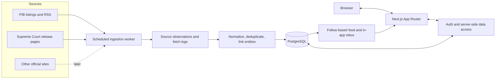

# Civic India v0.1 System Architecture

**Status:** Draft for implementation planning  
**Date:** 6 October 2026  
**Product thesis:** A citizen-first, evidence-led information layer whose front door answers: **What changed in the civic world I follow?**

This document translates the product thesis and data architecture into a bounded first release. It describes the target system shape and the smallest prototype that can test source ingestion, entity follows, and timely in-app updates. It is planning-only; it does not authorize or include application code.

## 1. Executive summary

The v0.1 prototype will:

1. Collect official press-release updates from two source websites.
2. Preserve the original source, timestamps, language, and provenance.
3. Link each update to one or more known civic entities when that link is reliable.
4. Let people register, log in, follow or unfollow an entity, and see relevant updates.
5. Create one in-app notification for a newly ingested update that matches a user's follows.
6. Represent real-world events separately from the documents that report them.

The recommended pilot connectors are **PIB All Releases** and **Supreme Court of India Press Releases**. PIB provides a broad Union-government release stream, ministry filters, and an RSS listing. The Supreme Court feed adds a separate institution and a different page format. The official pages currently show source sections and records that support this split: [PIB All Releases](https://www.pib.gov.in/AllRelease.aspx?lang=1&reg=1), [PIB RSS](https://www.pib.gov.in/ViewRss.aspx?lang=1&reg=22), and [Supreme Court Press Releases](https://www.sci.gov.in/press-release/).

The v0.1 application uses **Next.js App Router** and **PostgreSQL**. A scheduled ingestion worker runs separately from web requests but shares the same codebase and database. The first release uses in-app notifications; email, push, AI summaries, social signals, and graph exploration belong to later stages.

## 2. Goals and boundaries

### Goals

- Prove that people can create an account and follow a civic entity.
- Ingest new official releases from two distinct sources without creating duplicates on repeat polls.
- Make a release's issuer, original URL, publication time, retrieval time, and language visible.
- Build a simple personalized feed and notification inbox from the same canonical records.
- Preserve a data model that can grow from two to ten source connectors without redesigning user follows.
- Test whether the “what changed?” loop encourages people to return and inspect primary evidence.

### v0.1 non-goals

- AI-generated summaries or question-answering.
- Automated political interpretation, ranking, or factuality judgments.
- News-media aggregation, social posts, ownership analysis, or live trend signals.
- Email, SMS, browser push, or mobile push notifications.
- A public graph interface, vector search, or a separate graph database.
- Automatic event clustering across documents when the relationship is uncertain.
- Broad ingestion of court judgments, bills, parliamentary debates, or datasets.

## 3. Source strategy

### Initial two connectors

| Connector | Pilot role | Initial treatment |
|---|---|---|
| Press Information Bureau (PIB), All Releases | Broad Union-government releases across ministry and secretariat sections | Read the RSS/listing for new items, then fetch release details. Store PIB as the publication source and the ministry or secretariat as the issuing entity when the source identifies it. |
| Supreme Court of India, Press Releases | Judicial institution coverage and a different listing/detail format | Read the release listing, fetch each detail page, and preserve the original language. The current listing includes Hindi and English material. |

The first backfill should be small: for example, the most recent 30 days, capped at roughly 100 records per connector. Historical backfill does not produce user notifications. After the backfill, poll hourly as a starting point, with a configurable interval for each source and conservative request behavior.

### Candidate ten-source registry

This is an onboarding queue, not a promise to build ten scrapers in v0.1. Each source must pass a short audit for content scope, pagination, language, identifiers, update cadence, attachment handling, and source-access policies. Some parliamentary pages contain reports and notices as well as releases; the connector must preserve document type instead of labelling every item a press release.

| # | Candidate connector | Role / notes |
|---:|---|---|
| 1 | [PIB All Releases](https://www.pib.gov.in/AllRelease.aspx?lang=1&reg=1) | Pilot; Union ministries and departments, with RSS available. |
| 2 | [Supreme Court Press Releases](https://www.sci.gov.in/press-release/) | Pilot; Supreme Court and eCommittee releases. |
| 3 | [PM India News Updates / PMO](https://www.pmindia.gov.in/en/news-updates/) | Direct PMO source; compare with PMO items already carried by PIB before adding. |
| 4 | [President of India Press Releases](https://presidentofindia.nic.in/press-release?page=0) | Direct President's Secretariat source. |
| 5 | [Digital Sansad — Lok Sabha Press Releases](https://sansad.in/ls/pressRelease) | Press releases and speaker/secretariat updates. |
| 6 | [Digital Sansad — Rajya Sabha Press Releases](https://sansad.in/rs/pressRelease) | Committee and House-related releases; validate item types and publication dates. |
| 7 | [Ministry of Home Affairs](https://www.mha.gov.in/en/current-affairs) | Ministry press-release section and current-affairs records. |
| 8 | [Ministry of External Affairs](https://www.mea.gov.in/press-release-.htm) | Media-center press releases. |
| 9 | [Department of Economic Affairs, Ministry of Finance](https://dea.gov.in/index.php/archive/documents-press-release) | Press releases, including PDF communiqués. |
| 10 | [Department of Financial Services, Ministry of Finance](https://financialservices.gov.in/press-release?page=1) | Department press-release archive. |

The PIB, PMO, President, and ministry connectors can contain overlapping records. Store every source observation and URL, then link observations to a canonical document when identity is clear. A matching title or body hash alone should flag a possible duplicate for review, not silently erase source provenance.

## 4. System architecture

### Components

**Next.js web application**

- Use App Router pages and server-rendered reads for the feed, entity pages, document pages, and notification inbox.
- Use server actions or route handlers for sign-up, sign-in, follow/unfollow, read state, and other mutations.
- Keep user-specific database access behind a server-side data-access layer. Verify the session and authorization at the data operation, including each mutation. The Next.js authentication guide recommends using an authentication library and centralizing secure checks in a data-access layer: [Next.js Authentication](https://nextjs.org/docs/app/guides/authentication).

**Authentication**

- Use **Better Auth** with the `@better-auth/drizzle-adapter` for email/password authentication, password hashing, and database-backed sessions.
- Persist the application user ID and session data in PostgreSQL through Drizzle.
- Email verification is disabled for the local prototype because no outbound email service is configured; revisit before a public launch.
- Use secure, HTTP-only session cookies. Keep password material out of application logs and user-facing error messages.

**Scheduled ingestion worker**

- Runs independently from web requests, on a scheduler or cron facility.
- Uses one adapter per source website/section. Each adapter defines its listing URL, content types, pagination or RSS cursor, parser version, and date/language handling.
- Fetches new listing entries and detail pages, normalizes the records, writes source observations, and updates entity links.
- Logs each run and retries transient failures with backoff. A failed source does not block other sources.
- Uses a source-specific polling interval and request rate. Prefer conditional requests when a source supports them.

**PostgreSQL**

- Stores users, follows, entities, normalized documents, source provenance, event links, notification state, and ingestion run history.
- Is the canonical store for v0.1. The civic graph remains a logical relational model; a graph database is not required at this stage.
- Can support basic full-text search in a later phase without adding a separate search service immediately: [PostgreSQL Full Text Search](https://www.postgresql.org/docs/current/textsearch.html).

### Ingestion and notification flow

1. The scheduler starts a run for a source and records a run ID and start time.
2. The adapter reads the source listing or RSS feed and selects entries newer than its checkpoint.
3. It fetches detail pages and extracts the source title, body, publication date, language, original URL, source item ID, and issuer metadata where available.
4. The pipeline normalizes dates and URLs, calculates a content hash, and upserts the source observation. It creates or updates the canonical document without discarding source observations.
5. The source's explicit issuer is linked to a seeded entity. Additional entity links are added only when their evidence is clear.
6. If this is a new canonical document and it is not part of historical backfill, the worker finds users who follow its linked entities and inserts one notification per user/document.
7. The worker records counts and completion status. The feed and inbox read the committed records from PostgreSQL.

New document, entity links, and notification inserts should be committed together so a user does not receive an alert for a record that failed to persist. Re-running a source poll should be safe and should not create another document or notification.

## 5. Data model

### Entity identity

An entity is a civic person or institution, not a website. Give it a stable ID and slug, a display name, a type, aliases, and an active flag. Names and source URLs may change without changing the entity ID.

Seed a small catalog for the requested follows: Prime Minister, PMO, President of India, Parliament, Lok Sabha, Rajya Sabha, Supreme Court of India, and selected Union ministries. A user may follow an entity before its dedicated connector is active; its page should explain that coverage has not started yet.

For the pilot, map PIB issuer metadata to ministry/secretariat entities and map Supreme Court releases to the Supreme Court entity. Add person-level links only when supported by source metadata or a reviewed rule. Do not create alerts from a weak keyword match alone.

### Logical tables

| Table | Important fields and constraints |
|---|---|
| `users` | `id`, normalized unique `email`, auth-library fields; optional account status. |
| `user_feed_state` | `user_id`, `last_seen_at`; one row per user if the last-visit catch-up needs a separate cursor. |
| `entities` | `id`, unique `slug`, `name`, `type`, aliases, `active`. |
| `sources` | `id`, unique `key`, name, site/listing URL, content scope, poll interval, enabled flag, last successful run. |
| `ingestion_runs` | `source_id`, start/end times, status, pages/items read, records created/updated, error summary, adapter version. |
| `documents` | `id`, title, document type, normalized body/excerpt, language, `published_at`, `first_seen_at`, content hash. `published_at` may be unknown. |
| `document_sources` | `document_id`, `source_id`, source URL, source item ID, retrieved time, source publication string, preserved source snapshot/body, MIME type, checksum. Unique by source plus stable item ID or normalized source URL. |
| `document_entities` | `document_id`, `entity_id`, relation (`issuer`, `about`, or later `mentions`), evidence, confidence, mapping method. |
| `events` | `id`, title, type, optional occurrence time, curation status, confidence. Create only when the event is supported clearly. |
| `event_documents` | Many-to-many link between an event and supporting documents. |
| `user_follows` | `user_id`, `entity_id`, `created_at`; unique `(user_id, entity_id)`. |
| `notifications` | `id`, `user_id`, `document_id`, created time, nullable `read_at`; unique `(user_id, document_id)`. |

Use foreign keys for relationships and database uniqueness for idempotency. Store source publication time separately from retrieval/first-seen time. Preserve original language and source text; do not silently translate or overwrite source content.

For HTML pages, keep the original source URL and a compact source snapshot or extracted original body in `document_sources`. For PDF attachments, retain the URL, MIME type, retrieval time, and checksum; use a durable file store if retaining the binary becomes necessary.

## 6. Application flows

### User registration and follows

1. A visitor registers with email and password.
2. The application validates input server-side, creates the account/session, and sends the user to the entity directory.
3. The user follows or unfollows entities.
4. The feed shows documents linked to followed entities, ordered by publication time, with first-seen time available where publication time is missing.

### Feed and notifications

- The feed is a query over canonical documents, document/entity links, and the user's follow records.
- The notification inbox contains new, relevant documents and read/unread state.
- A notification is generated only for a newly ingested document after the initial backfill.
- If one document matches several followed entities, create one notification and show all matching entity labels on the card.
- Notifications are in-app only for v0.1. Email and push channels are later decisions.

### Document and event pages

Each document page shows its title, issuing entity, source name, published time, first-seen time, language, excerpt/body, and a prominent original-source link. An event page lists its supporting documents and the basis for the association. Documents remain visible when no event has been created or when event grouping is uncertain.

### Initial routes

| Route | Purpose |
|---|---|
| `/register`, `/login`, `/logout` | Account lifecycle |
| `/api/auth/[...all]` | Better Auth registration, login, session, and logout endpoints |
| `/dashboard` | Signed-in account and follow overview |
| `/api/follows` | Authenticated follow/unfollow mutations |
| `/feed` | Personalized update feed and catch-up |
| `/entities` | Followable entity directory |
| `/entities/[slug]` | Entity profile, follow state, and linked updates |
| `/documents/[id]` | Source-backed release details |
| `/events/[id]` | Event and linked documents, when curated |
| `/notifications` | In-app notification inbox and read state |

## 7. Event handling and evidence rules

- A document is a source publication; an event is a real-world occurrence. They are separate records.
- A single event may have several official documents, and a document may exist without a linked event.
- For v0.1, create event records through a small set of explicit rules or manual curation. Do not run automatic cross-source clustering or LLM extraction.
- Retain the source text and URL even if a short excerpt is displayed in the feed.
- Show the issuing source and the time Civic India retrieved the item. An official release is evidence of what that office published; it is not automatically a complete or independently verified account of every underlying claim.
- Derived summaries, embeddings, classifications, and claims belong in later phases and must remain traceable to source records.

## 8. Reliability, security, and operations

### Ingestion reliability

- Track last successful poll and next scheduled poll per source.
- Store run status and error summaries; retry temporary failures without rapidly repeating requests.
- Upsert by stable source ID or normalized URL. Use hashes to detect changed content and possible duplicates.
- Keep parser behavior versioned so a source page change can be diagnosed and records can be reprocessed.
- Do not send user notifications from historical import or failed partial runs.

### Account and data security

- Keep authentication and authorization checks on the server for every private page and mutation.
- Treat follow state, saved/read state, and notification state as private user data.
- Use parameterized database access, secret configuration outside source control, and redacted application logs.
- Collect only account information needed for login and the prototype. Do not expose user emails or follows in public entity/document pages.

### Monitoring

Track per source: last successful run, ingestion lag, new/updated item counts, parser failures, duplicate candidates, and missing publication dates. For the product pilot, track follows completed, notification opens, original-source clicks, and return visits. These measure both source quality and the “what changed?” behavior.

## 9. Implementation sequence

1. **Source audit and content contract:** verify the two pilot pages, item types, access policies, date parsing, pagination/RSS behavior, languages, and detail links.
2. **Ontology and seed data:** define entity types, stable slugs, issuer mappings, document types, and the starter entity catalog.
3. **Auth and follow loop:** registration/login/logout, session-backed user identity, follow/unfollow, and entity directory.
4. **Two-source ingestion:** initial small backfill, scheduled polling, source snapshots, provenance, idempotent upserts, and run logging.
5. **Feed and inbox:** chronological follow-based feed, new-update badge/inbox, one notification per user/document, and read state.
6. **Event sample:** curate or rule-link a small set of clear events; preserve documents that cannot be confidently grouped.
7. **Pilot review:** test with a small group before expanding source coverage. Review relevance, source links, feed comprehension, return behavior, and parser reliability.

## 10. Acceptance criteria

The prototype is ready for a pilot when:

- A user can register, log in, log out, and maintain an authenticated session.
- A user can follow and unfollow seeded entities, including Prime Minister/PMO and Supreme Court.
- The two pilot connectors ingest current records and show the original source URL, issuer, language, publication time when available, and retrieval time.
- Re-running the same poll creates no duplicate document and no duplicate notification.
- A new document linked to an entity creates exactly one unread in-app notification for each user who follows that entity; a user without a matching follow receives none.
- Reading an alert updates its read state.
- A release remains a document when no reliable event link exists; curated events can link to one or more supporting documents.
- Failed source runs are visible and retryable without preventing the other connector from running.
- Users can reach the primary source from every feed card and document page.

## 11. Deferred architecture stages

After v0.1 proves ingestion quality and user return behavior, extend the same model in this order:

1. Add the remaining source connectors and historical source observations.
2. Add PostgreSQL full-text search across documents and entities.
3. Add topics, locations, source-backed relationships, and time-bounded institutional relationships.
4. Improve event resolution and review tools.
5. Add source-grounded Q&A and catch-up summaries with citations to documents.
6. Add news comparison and ownership provenance, then carefully labelled public/social signals.
7. Introduce a queue, object storage, search/vector infrastructure, or graph projection when measured workloads require them.

## 12. Decisions to make before implementation

- What request interval is appropriate for each pilot source after reviewing its usage policies?
- Should public sign-up require verified email once an outbound email service is configured?
- Should the initial entity catalog include every Union ministry, or only entities with pilot-source coverage?
- Which four ministry-specific connectors should follow the first two, based on user interest and source quality?
- What retention period applies to raw HTML snapshots and downloaded source attachments?
- Is the initial language policy to show source language only, or should a later phase add human-reviewed translations?
- What pilot group and return-window will be used to judge the “what changed?” loop?

## References

- [Civic India Product Thesis and Data Architecture](../../Civic_India_Product_Thesis_and_Data_Architecture.pdf)
- [Next.js Authentication Guide](https://nextjs.org/docs/app/guides/authentication)
- [PostgreSQL Constraints](https://www.postgresql.org/docs/current/ddl-constraints.html)
- [PostgreSQL Full Text Search](https://www.postgresql.org/docs/current/textsearch.html)
